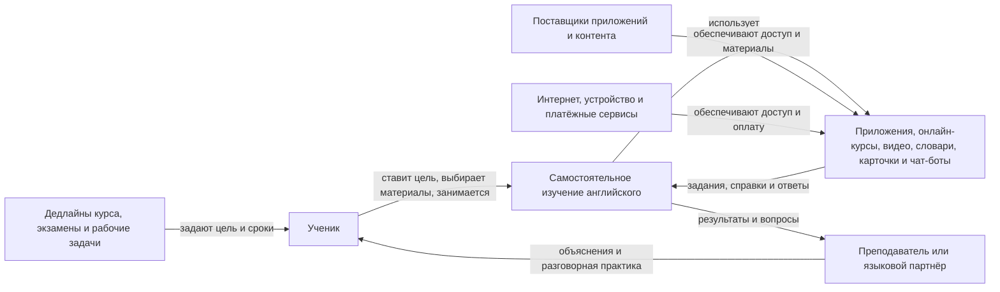

# Лабораторная работа 1
## Границы и цель системы

### Описание существующей системы

До появления AI.English человек обычно изучает английский самостоятельно с помощью нескольких разрозненных средств: приложений и онлайн-курсов, видео, словарей, карточек, переводчиков, чат-ботов и разговорной практики с преподавателем или знакомыми. Ученик сам выбирает материалы, планирует занятия, переключается между инструментами и решает, как отслеживать прогресс; обратная связь и фиксация повторяющихся ошибок зависят от выбранного способа обучения. Эта система существует сейчас и решает задачу изучения английского без единого общего процесса.

## Как учат сейчас (AS-IS)

Текущий процесс самостоятельного изучения английского обычно состоит из нескольких действий и инструментов:

1. Возникает задача: понять тему, подготовиться к разговору или написать письмо.
2. Ученик ищет подходящий материал: открывает учебник, приложение, поисковик, Telegram-чат или спрашивает преподавателя.
3. Пытается составить фразу или выполнить упражнение.
4. Проверяет себя по словарю, переводчику, ответам приложения или обратной связи собеседника.
5. Использует результат и, если вспомнит, сохраняет ошибку для повторения.

Точка возможного отказа: если ученик не находит подходящую формулировку или ответ быстро, он может отложить задачу или воспользоваться первым найденным переводом. Порог «две минуты» — гипотеза для проверки наблюдением, а не установленный факт.

| Альтернатива AS-IS | Для чего используют | Возможное ограничение |
| --- | --- | --- |
| Telegram-чаты и языковые сообщества | Найти собеседника, задать вопрос, обменяться материалами | Качество и скорость ответа зависят от участников; беседа может уйти от учебной цели |
| Приложения вроде Duolingo | Регулярно выполнять короткие упражнения и повторять лексику | Упражнения могут не совпадать с конкретной рабочей или разговорной задачей пользователя |
| Репетитор или преподаватель | Получать объяснения, практиковать разговор и получать персональную обратную связь | Нужно согласовать время и оплату; самостоятельная практика между занятиями остаётся на ученике |
| Бумажные учебники и справочники | Изучать правила и выполнять структурированные упражнения | Сложно быстро получить обратную связь по собственной фразе или произношению |
| Поиск, переводчики и чат-боты | Быстро найти перевод, правило или пример формулировки | Пользователь сам оценивает точность, уместность и соответствие своему уровню; прогресс может не сохраняться в одном месте |

Ограничения в таблице — рабочие предположения о типичных способах использования. Их следует уточнить на интервью и наблюдениях, а не считать универсальными свойствами перечисленных сервисов.

### Контекстная диаграмма AS-IS

## Будущая система (TO-BE): AI.English

AI.English — проектируемый продукт, а не часть AS-IS. Предполагается, что он объединит диалоговую практику, сценарии рабочих ситуаций, объяснение ошибок и историю занятий. Он может сократить переключения между инструментами и дать возможность репетировать разговор, но не заменяет автоматически преподавателя, поисковик или все функции учебных приложений.

## Граница системы
### Внутри системы
- действия ученика по самостоятельному изучению английского: постановка учебной цели, выбор темы, планирование и выполнение занятий;
- используемые для этой цели приложения, онлайн-курсы, видео, словари, карточки и чат-боты;
- получение доступной обратной связи и самостоятельная фиксация прогресса, если ученик это делает.

### Во внешней среде, но влияет на систему
- преподаватели, репетиторы и языковые партнёры, которые помогают практиковаться и объясняют ошибки;
- требования курса, учебные дедлайны, экзамены и рабочие задачи, влияющие на цели и сроки;
- поставщики обучающих приложений и контента, а также платёжные сервисы;
- доступность устройства и интернета.

### Не относится к выбранной границе системы
- разработка и проведение официальных экзаменов как самостоятельный процесс;
- работа учебных заведений и работодателей по аттестации или найму;
- офлайн-уроки, если ученик не использует их как часть своего процесса самостоятельной практики.

### Спорные элементы и решения по ним
- Чат-боты, словари и обучающие приложения включены внутрь, только когда ученик использует их как инструменты своего процесса. Компании, которые разрабатывают эти сервисы, находятся снаружи.
- Преподаватель или языковой партнёр не входит в самостоятельный процесс ученика, но может влиять на него через разговорную практику и обратную связь.
- Экзамен, дедлайн или рабочая встреча задают цель обучения, но само проведение экзамена или рабочей встречи не относится к изучаемому процессу.

### Как изменится анализ при другой границе

- Если расширить границу до всей системы языкового образования, внутрь попадут занятия с преподавателем, учебная программа и оценивание. Тогда цель и критерии придётся связать также с результатами курса и работой преподавателя.
- Если сузить границу до одного приложения, другие ресурсы и самостоятельное планирование станут внешней средой. Тогда анализ будет оценивать конкретное приложение, а не весь процесс изучения языка.

## Заинтересованные стороны

| Сторона | Цель и критерий успеха | Возможное последствие проблем | Конфликт интересов |
| --- | --- | --- | --- |
| Ученик | Быстро начать полезную практику: целевой ориентир TO-BE — первый содержательный диалог не позднее 2 минут после запуска | Теряет время, может закрепить ошибку или прекратить занятия | Хочет заниматься без отвлечений и по доступной цене; рекламная модель может прерывать занятие |
| Преподаватель или репетитор | Помогать ученику достигать учебных целей; гипотеза для TO-BE — автоматизация типовых исправлений может сократить время ручной проверки на 70% | Тратит больше времени на повторяющиеся ошибки или получает неверную оценку прогресса | Автоматическая проверка экономит время, но не должна подменять профессиональную оценку сложных ошибок |
| Поставщик обучающего сервиса / владельцы AI.English | Обеспечить устойчивую экономику; предварительные целевые ориентиры — LTV > 3000 ₽ и CAC < 800 ₽ | Высокие расходы или низкое удержание делают сервис неустойчивым | Доход от рекламы или подписки может конфликтовать с желанием пользователя заниматься без прерываний |
| Методист или автор материалов | Обеспечить корректность и соответствие заданий уровню учащегося | Неточные объяснения снижают доверие и могут закрепить ошибку | Проверка качества требует времени, а быстрая публикация контента может увеличить риск неточностей |
| Работодатель или учебное заведение | Получить сотрудника/учащегося, способного решать реальные рабочие или учебные задачи на английском | Ошибки в коммуникации ведут к задержкам и недопониманию | Организации могут требовать быстрый результат, тогда как ученик выбирает собственный темп и цели |

Числа для времени первого диалога, LTV, CAC и сокращения проверки — **проектные ориентиры-гипотезы**, а не подтверждённые результаты или фактические показатели текущей системы. Их нужно пересмотреть после пилота и появления данных.

### Конфликт и предположение о монетизации

Владельцам может быть выгодно показывать рекламу, а пользователю важно вести непрерывный диалог без отвлечений. Проверяемая гипотеза: баннер после каждого пятого сообщения может снизить долю повторных сессий на 15%. Эти 15% — не результат измерения, а ориентир для проверки экспериментом. Альтернатива для теста — показывать рекламу только вне активного диалога или отказаться от неё в учебном режиме.

В доступных материалах проекта нет интервью с финансовым директором, выгрузки Stripe или фактической аналитики платежей. Поэтому реклама, подписка, LTV, CAC и конверсия описываются как бизнес-гипотезы, а не как существующая подтверждённая модель монетизации.

## Цель системы и признак достижения

**Цель текущей системы в интересах ученика:** за 8 недель регулярной практики улучшить разговорный английский. Проектный критерий: не менее 70% участников, занимавшихся минимум 3 раза в неделю, повышают результат одинакового входного и итогового задания минимум на одну заранее определённую ступень, а число грамматических и лексических ошибок на 50 реплик снижается не менее чем на 30% относительно входного измерения.

Это целевой порог, а не измеренный факт. Проверка: входной и итоговый тесты оцениваются по одной шкале; ошибки на выборке из 50 реплик размечаются по единому правилу; регулярность занятий рассчитывается по истории сессий. Для AS-IS данные можно собирать в дневнике участника или локальном экспорте; для пилота TO-BE — в таблице/SQLite и стандартизированной оценке.

### KPI будущего продукта и способ измерения

Пороги ниже — **предварительные цели MVP**, а не текущие результаты. Baseline оттока и платежей неизвестен; его нужно измерить на первой когорте до сравнения с целевыми значениями.

| Метрика | Целевой порог | Как проверять |
| --- | --- | --- |
| Время до первого успешного диалога | Медиана ≤ 2 минут от запуска до завершённой осмысленной реплики | События запуска и первой завершённой реплики; локальные логи/экспорт SQLite, при согласии — self-hosted PostHog |
| Удержание первой недели | Доля пользователей, вернувшихся на 2–7 день, ≥ 65% (соответствует целевому оттоку ≤ 35%; исходный baseline измерить) | Когортный отчёт по дате регистрации в локальной аналитике или self-hosted PostHog |
| Регулярность | DAU/MAU ≥ 25%; медианный интервал между занятиями ≤ 48 часов | События начала/окончания сессий в SQLite или self-hosted PostHog; заранее определить активное занятие |
| Качество занятий | Доля оценённых пользователями сессий с оценкой ≥ 4 из 5 составляет ≥ 70% | Встроенная оценка после занятия и выгрузка агрегатов; отдельно отслеживать число ответивших |
| Обучающий результат | ≥ 70% участников пилота улучшают результат на одну ступень; ошибок на 50 реплик становится на 30% меньше | Парные входные/итоговые задания и проверка по единой рубрике |
| Надёжность | Для локального MVP: ≥ 99,5% сессий без аварийного завершения. Если появится серверный API: доступность ≥ 99,5% в месяц | Локальные crash-логи; для серверной версии — Prometheus/Grafana. 99,5% доступности соответствует примерно 3 ч 36 мин простоя в 30-дневный месяц |
| Конверсия в оплату | Гипотеза: trial→paid ≥ 12% среди пользователей с медианным интервалом между сессиями ≤ 24 часов | Только после запуска триала и оплаты: когортный отчёт платёжного провайдера; до этого метрика неприменима |
| Экономика привлечения | Гипотеза: LTV > 3000 ₽ при CAC < 800 ₽ | Рассчитывать по подтверждённым расходам привлечения и фактическим платежам; сейчас исходных данных нет |

Поскольку архитектурный ориентир проекта — локальное хранение, внешняя аналитика не должна получать аудио, тексты диалогов или персональные данные без отдельного согласия. До выбора аналитики можно собирать минимальные агрегированные события локально. Stripe, Amplitude и внешняя Grafana не считаются уже подключёнными источниками данных.

### Чья это цель и чьи интересы она затрагивает

Цель сформулирована прежде всего с позиции ученика и качества обучения. Ученик может поддержать её, если оценивание прозрачно и занятия не требуют чрезмерных затрат. Преподаватель может согласиться с улучшением навыков, но оспорить достаточность теста или порог в одну ступень. Поставщик сервиса может предпочесть рост удержания и выручки; цель обучения не гарантирует эти бизнес-результаты. Работодатель может хотеть более быстрый прогресс по конкретным рабочим ситуациям, а не общий языковой уровень. Поэтому выбранная цель не представляет автоматически интересы всех сторон.

## Наблюдения за текущей системой (теоретические примеры)

Ниже — **смоделированные учебные эпизоды**, а не подтверждённые полевые наблюдения. Имена, возраст, места и время условны. Они помогают показать формат наблюдения; фактические выводы требуют реальных наблюдений.

1. **Анна, 24 года — офис, open-space, будний день, 14:30.** Анна готовит ответ иностранному клиенту: вводит исходное письмо в переводчик, ищет примеры деловых фраз и собирает ответ из нескольких шаблонов. **Удивило:** в этой ситуации ей важнее быстро подобрать уместную формулировку, чем проходить общее грамматическое упражнение; это противоречит предположению, что любая учебная потребность начинается с изучения правила.
2. **Михаил, 45 лет — поездка на работу пассажиром, 08:10.** Он слушает подкаст на английском и пытается повторять услышанные фразы; незнакомый фрагмент переслушивает позже, когда может безопасно посмотреть телефон. **Удивило:** для практики ему нужно связать аудио с текстом и разбором непонятного места, но эти действия оказываются разделены между проигрывателем и другими инструментами. Сценарий не предполагает использование телефона водителем.
3. **Елена, 32 года — дома, онлайн-занятие с репетитором, будний вечер.** В начале видеозвонка Елена и преподаватель разбирают письменное домашнее упражнение, затем переходят к разговорной практике. **Удивило:** часть времени индивидуального урока уходит на проверку типовых письменных ошибок, хотя главная цель занятия — практика речи. Точная доля времени в этом учебном примере не измерялась и не указывается.

Эти примеры не подтверждают распространённость проблем. Если преподаватель требует реальный поход в систему, их нужно заменить наблюдениями с фактическими датой, местом, действиями и согласием участников.

## Вывод

AS-IS — самостоятельное изучение английского с помощью приложений, учебных материалов, поиска, переводчиков и, когда доступно, преподавателя или языкового партнёра. Его преимущества — гибкость и широкий выбор ресурсов; возможная проблема — необходимость самому связывать инструменты и отслеживать прогресс. TO-BE — AI.English, проектируемый помощник для диалоговой практики и обратной связи. Гипотезы об ограничениях текущего процесса, KPI и монетизации требуют подтверждения реальными наблюдениями, интервью и пилотными данными.
