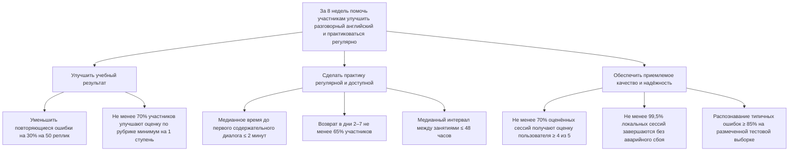

# Лабораторная работа 2
## Структура и дерево целей AI.English

**Цель работы:** разложить проектируемую систему AI.English на элементы разными способами и декомпозировать её цель до измеримых показателей. AI.English пока находится на стадии проектирования, поэтому приведённые пороги — целевые гипотезы для пилота, а не достигнутые результаты.

## 1. Две декомпозиции системы

Для анализа будущей системы используем два основания: функции, которые выполняет продукт, и состав его компонентов.

### 1.1. Декомпозиция по функциям

1. **Начало и настройка занятия:** выбор уровня английского, темы и образа собеседника.
2. **Разговорная практика:** свободный или сценарный диалог, включая рабочие встречи, презентации и конференции.
3. **Обработка текста:** проверка фраз, предложение исправлений и объяснение типичных ошибок.
4. **Обработка голоса:** запись речи, распознавание аудио и предполагаемый анализ произношения.
5. **Персонализация тренировки:** подбор сложности и упражнений на основе повторяющихся ошибок.
6. **Отслеживание прогресса:** сохранение уроков, ошибок и динамики занятий.
7. **Защита данных:** локальное хранение аудио и истории, удаление урока и резервное копирование.

Эта декомпозиция показывает, **какую ценность и пользовательский путь** должна обеспечить система. Она выявляет, например, что диалог, обратная связь и прогресс — связанные, но самостоятельные функции.

### 1.2. Декомпозиция по составу

1. **Интерфейс приложения:** выбор режима, чат, голосовой виджет и отображение обратной связи.
2. **Оркестратор диалога:** управление ролью собеседника, темой, уровнем сложности и ходом сценария.
3. **Локальная языковая модель:** генерация реплик и объяснений.
4. **ASR-модуль:** локальное преобразование речи пользователя в текст, например на основе Whisper.
5. **Модуль анализа произношения:** сопоставление распознанной речи с целевыми фразами и выделение ошибок; конкретная реализация требует технической проверки.
6. **Локальная база данных:** настройки, история уроков, оценки и список ошибок; предполагаемый вариант — SQLite.
7. **Аудиокомпоненты:** запись, воспроизведение и визуализация аудио, например с использованием FFmpeg и Canvas.
8. **Локальные материалы:** сценарии диалогов, языковые примеры и правила для разных уровней.
9. **Резервное копирование и удаление данных:** создание резервной копии и удаление связанных аудио, текста и метаданных по запросу пользователя.

Эта декомпозиция показывает **технические границы, зависимости и риски реализации**. Например, функция голосовой обратной связи опирается как минимум на запись аудио, ASR и анализ произношения.

### Сравнение декомпозиций

Функциональная декомпозиция показывает, что должен уметь делать пользовательский продукт и где возникают пробелы в обучающем процессе. Декомпозиция по составу показывает, какие программные модули для этого понадобятся и от каких компонентов зависит результат. Первая сама по себе не раскрывает техническую сложность локального ASR, а вторая не объясняет, помогает ли конкретный компонент пользователю достигать учебной цели. Для планирования нужны обе перспективы.

## 2. Дерево целей

**Верхнеуровневая цель:** за 8 недель пилота помочь пользователям регулярно практиковать разговорный английский и уменьшить повторяющиеся ошибки. Целевой критерий результата: не менее 70% участников, занимавшихся минимум 3 раза в неделю, улучшают результат по единой рубрике хотя бы на одну ступень, а число ошибок на 50 реплик уменьшается на 30% относительно входной проверки.

Все значения ниже — **предварительные пороги пилота**. Сбор продуктовой аналитики и измерения модели пока не настроены.

| Лист дерева целей | Показатель и единица измерения | Целевой порог | Как получить значение |
| --- | --- | --- | --- |
| Снижение повторяющихся ошибок | Ошибки на 50 реплик; процент изменения от входного замера | Снижение не менее чем на 30% за 8 недель | Одинаковые входное и итоговое задания; ручная разметка по единой рубрике |
| Рост разговорного навыка | Ступени оценки по рубрике; доля участников, % | Не менее 70% участников улучшают оценку минимум на 1 ступень | Входное и итоговое устное задание, оценённое по одной шкале |
| Быстрый старт практики | Медианное время, минуты | Не более 2 минут от запуска до первой содержательной реплики | Локальные временные метки запуска и первой завершённой реплики; сейчас данные отсутствуют |
| Возврат после начала занятий | Доля участников, вернувшихся в дни 2–7, % | Не менее 65% (соответствует целевому D7-оттоку не выше 35%) | Когорта пилота по локальным датам регистрации и сессий; baseline пока отсутствует |
| Регулярность занятий | Медианный интервал между сессиями, часы | Не более 48 часов | Временные метки начала занятий в локальной базе |
| Удовлетворённость сессиями | Доля оценённых сессий с оценкой ≥ 4/5, % | Не менее 70% | Локальный вопрос после занятия; отдельно учитывать долю ответивших |
| Стабильность приложения | Сессии без аварийного завершения, % | Не менее 99,5% | Локальные crash-логи и число завершённых/начатых сессий |
| Точность распознавания ошибок | Правильно распознанные типичные ошибки, % | Не менее 85% на размеченной тестовой выборке | Сравнить ASR/анализ с ручной разметкой; тестовый набор ещё предстоит собрать |

Если пилот останется полностью локальным, показатели можно считать из SQLite и локальных журналов с согласия участников. Если появится серверная часть, доступность API можно измерять отдельно: целевой порог — **не менее 99,5% времени в месяц**, источник — мониторинг Prometheus/Grafana. Сейчас API и такой мониторинг не заявлены как существующие, поэтому этот показатель не является текущим результатом.

## 3. Конфликт целей

Один из конфликтов — **скорость и приватность локальной обработки против точности анализа речи**. Обработка аудио и работа модели на устройстве лучше соответствуют требованию не отправлять голос на внешний сервер, но доступная вычислительная мощность компьютера ограничивает размер и скорость модели. Более быстрая компактная модель может ошибаться чаще; более точный анализ может дольше обрабатывать запись и требовать более мощного устройства. Поэтому максимум по приватности и локальности не гарантирует одновременно максимальную точность и минимальную задержку.

В рамках MVP этот спор будет решать продуктовая и техническая команда: сравнить несколько локальных конфигураций на одной размеченной выборке и выбрать вариант, который укладывается в целевую задержку **3–5 секунд на запись**, не опускаясь ниже цели **85% точности типичных ошибок**. Это план выбора, а не уже проведённый benchmark. Пользователь задаёт требования к приватности и допустимому ожиданию; команда выбирает реализацию и сообщает её ограничения.

## 4. Какая ветка проседает

**Наиболее рискованная ветка — точность голосовой диагностики и фонетического анализа.** Это предварительная оценка по проектной документации: локальный ASR и фонетический анализ пока описаны как планируемые компоненты, а размеченной тестовой выборки и результатов измерения нет. Поэтому нельзя утверждать, что точность уже ниже 85%; известно только, что эту ветку ещё нечем подтвердить. Для её проверки нужны рабочий прототип, набор произнесённых фраз с ручной разметкой и измерения точности и задержки на целевых устройствах.

## 5. Вопросы приёмки

### Как узнать, что цель достигнута, и где взять число?

Для каждого листа дерева определены показатель, единица измерения, порог и источник в таблице KPI. До запуска пилота значений нет. После пилота учебный результат берётся из входных/итоговых заданий и разметки, регулярность — из временных меток занятий, качество — из оценок после сессий, стабильность — из локальных crash-логов. Для голосовой диагностики потребуется отдельная размеченная тестовая выборка.

### Что произойдёт, если довести до предела только левую ветку?

Если максимально улучшать только учебный результат и точность исправлений, можно выбрать более тяжёлую модель и подробную обратную связь. Тогда обработка станет медленнее, устройство может не справляться, а пользователь будет дольше ждать ответа. Он может реже заниматься, и общий результат системы ухудшится, даже если точность одной проверки вырастет. Поэтому точность нужно оценивать вместе с задержкой, регулярностью и стабильностью.

### Почему остановились на этом уровне и не пошли глубже?

Дерево остановлено там, где лист получает числовой показатель, единицу измерения, порог и способ проверки. Дальше можно декомпозировать уже реализацию метрики — например, виды фонетических ошибок или причины сбоев, — но это будет план тестирования и технического проектирования, а не цель верхнего уровня. Для текущей стадии важнее сначала проверить достижимость порогов на MVP, чем дробить неподтверждённые предположения ещё глубже.
